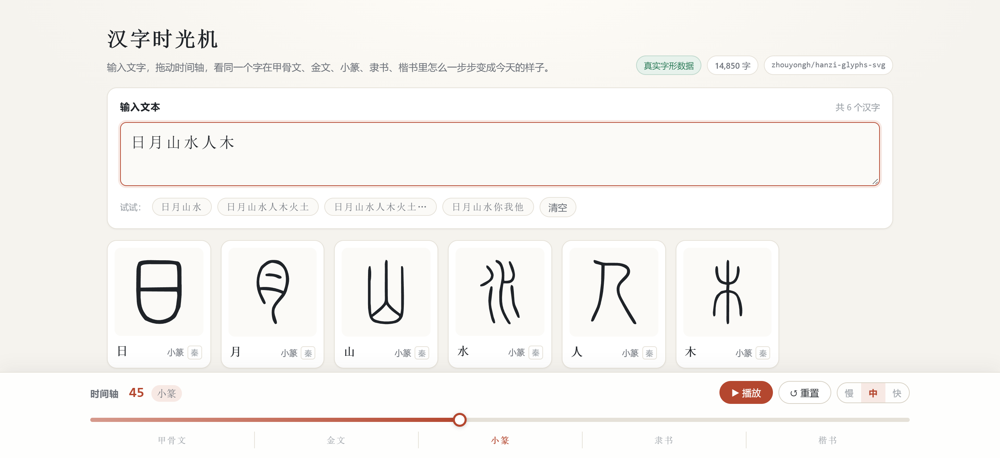

# 汉字时光机 · Font Time

输入一段中文，拖动时间轴，看每个字在 **甲骨文 → 金文 → 小篆 → 隶书 → 楷书** 之间同步切换字形。

字形库收录 **14,850 个汉字 / 27,196 个字形阶段**，体积约 122 MB，因此不做「一次性塞给浏览器」，
而是由一个极简 Node 服务按需分发：前端只请求当前文本用到的那几个字。



---

## 1. 项目简介

- 输入框默认值 `日月山水`，任意中文文本都会被拆成单字卡片。
- 拖动全局时间进度条（0–100）时，**所有卡片同步切换**到各自对应的阶段字形。
- 每个字按自己的阶段数量独立映射：阶段少的字（例如只有楷书的「你」）走得慢，阶段多的字（如「日」5 阶段）换得勤，但都从首阶段走到末阶段。
- 支持播放 / 暂停 / 重置 / 三档速度。
- 标点与空格保留为灰色占位格，不参与字形切换。
- 数据集里没有的字（如「龘」），显示汉字本身 + 「暂无字形数据」提示。
- 点击任意字形卡片可放大查看，并显示该字形的出处。

### 技术栈

| 用途 | 选型 |
| --- | --- |
| 构建 | Vite 8 |
| 框架 | React 19 + TypeScript 7 |
| 样式 | 原生 CSS（CSS 变量 + 响应式 + 深色模式） |
| 测试 | Vitest 5 |
| 服务端 | Node 22 原生 `http`（无框架）+ tsx |
| 数据脚本 | Node 22 + tsx |
| 包管理 | npm |

字形渲染全部使用 **内联 SVG**（构建期归一化到 `viewBox="0 0 100 100"`，颜色统一为 `currentColor`），因此可以跟随主题变色、任意缩放不失真。

### 为什么要一个 Node 服务端

全量数据是 14,850 个分字 JSON（约 122 MB）。如果按传统做法塞进 `public/` 静态目录：

- 首屏不需要它，但构建产物会变成 122 MB；
- 浏览器要么全量下载（不可接受），要么按字请求 14,850 个静态文件（静态服务器没有合并能力，一次 6 个字的文本要发 6 个请求）。

所以用 `server/api.ts` 做一个**按字索引层**：内存里只放一份 47 KB 的清单（字表 + 阶段顺序），
字形文件落在 `data/glyphs/` 里按码位命名，前端用**一次请求拿一批字**，服务端带 LRU 式缓存。

---

## 2. 数据来源与授权

### 2.1 真实数据源

字形来自开源项目 **[`zhouyongh/hanzi-glyphs-svg`](https://github.com/zhouyongh/hanzi-glyphs-svg)**（汉字字形 SVG 库，逐字形可溯源）。

本项目使用其中的五层，各自授权不同，**均为可商用/可再分发的开放许可**：

| 阶段 | 仓库目录 | 原始出处 | 授权 |
| --- | --- | --- | --- |
| 甲骨文 | `glyphs/oracle/` | 漢典 zdic.net 拓片摹本（题记含《甲骨文合集》合号与卜辞组别） | CC0 1.0 |
| 金文 | `glyphs/bronze/` | 漢典 zdic.net 青铜器拓片实例（题记含器名 + 集成号 + 时代） | CC0 1.0 |
| 小篆 | `glyphs/seal/` | 漢典 zdic.net 小篆实例（底本为《说文》刻本系统，公有领域） | CC0 1.0 |
| 隶书 | `glyphs/clerical/` | 漢典 zdic.net 隶书实例（汉碑、印谱、秦汉简牍） | CC0 1.0 |
| 楷书 | `glyphs/kaishu/` | 字体 **Ma Shan Zheng 2.003** 的轮廓派生件 | OFL 1.1 |

> 该仓库另有甲骨文 JGW 参数化数据集（CC BY 4.0，Zenodo DOI `10.5281/zenodo.22467946`）。
> 本项目**未使用**该批数据：同一目录下的漢典摹本是填充路径，与金文/篆书/隶书风格统一，视觉上更连贯。
> 若你替换成 JGW 骨架层，需按 CC BY 4.0 补上署名、注明修改并附协议链接。

### 2.2 覆盖情况（全量实测）

| 指标 | 数值 |
| --- | --- |
| 有字形的汉字 | **14,850** |
| 字形阶段总数 | **27,196** |
| 5 阶段 / 4 阶段 / 3 阶段 / 2 阶段 / 1 阶段 | 508 / 1,121 / 1,966 / 3,019 / 8,236 字 |
| 数据体积 | 约 122 MB（14,850 个分字 JSON + 47 KB 清单） |

**1 阶段占一半以上是数据源的客观情况**：甲骨文层只收 1,203 个常用字，小篆层覆盖率 93.5%，
越生僻的字越可能只剩楷书。前端不会因此错位——每个字按自己实际的阶段数重新分段，并在页面底部提示哪些字阶段不全。

### 2.3 取样规则（不伪造，只挑选）

一个字在同一书体下往往有多条实例（不同器物、碑帖、时代）。脚本的挑选规则是**确定性**的：

1. **甲骨文**：优先取漢典摹本（`char_form` 列为空的记录），没有才退回 JGW 骨架。
2. **金文**：按 `西周 → 周 → 春秋 → 戰國` 的偏好取第一条；都不命中则取最早一条。
3. **隶书**：按 `西漢 → 漢 → 新莽 → 東漢` 的偏好取第一条；都不命中则取最早一条。
4. **小篆 / 楷书**：每个字各只有一条，直接取。

年代标签（`era`）**一律来自数据源的 `period` 列**，只有该列为空时才退回该书体的典型年代（甲骨文→商、金文→周、小篆→秦、隶书→汉、楷书→今）。因此会出现「金文 · 戰國晚期」这类比示例更细的标注——这是数据源的实际情况，没有强行改写。

**准确性原则**：本项目不生成、不推断、不美化任何古文字形。字形字节来自上述开源库；唯一的加工是「按墨迹包围盒等比缩放到统一画布 + 颜色改为 currentColor + id 去重」，不改动任何笔画几何。

> 归一化用**墨迹包围盒**而不是源文件声明的 `viewBox`：漢典系 SVG 画布多为 400×400，但字形本身只占中间一小块，
> 直接按画布缩放会让字在卡片里显得又小又偏。脚本解析 `path d` 求真实包围盒再居中缩放，才有现在这种满格效果。

### 2.4 降级方案（占位数据）

如果**数据源完全不可达**，或显式执行 `npm run data:build:offline`，脚本会生成内置的占位数据（写入 `public/data/glyphs.json`）：

- 覆盖需求要求的全部 20 个字 × 5 个阶段；
- 每个字形是一个**明确的人造图形**：虚线外框 + 与阶段序号等量的横杠，`data-placeholder="true"`；
- 数据里 `placeholder: true`，页面顶部显示「示例占位数据」徽标 + 黄色提示条，每张卡片右上角有「占位」标记。

> 占位图形**刻意不模仿任何真实古文字形**，避免以臆造字形冒充真实字形数据。

---

## 3. 运行命令

```bash
npm install          # 安装依赖

npm run dev          # ① 首次会自动准备数据（拉源码 → 构建全量）② 启动开发服务器
                     #    默认 http://127.0.0.1:5173，端口被占用自动递增
npm run dev:only     # 跳过数据准备，直接启动 Vite（数据已构建时用这个，秒开）
npm run setup        # 只做数据准备：缺什么补什么（--force 强制重拉 + 重建）
npm run build        # 类型检查 + 生产构建，输出到 dist/（约 233 KB JS）
npm run start        # 生产服务：dist/ 静态文件 + /api 字形接口，默认 5174
npm test             # 单元测试（Vitest，30 个用例）
npm run data:build   # 重新构建字形数据（见第 5 节参数）
```

### 首次启动的自动准备

`npm run dev` 会先跑 `scripts/setup-source.ts`，按以下顺序拿原始字形仓库，命中即止：

1. 项目根 / 上级目录里已有的 `hanzi-glyphs-svg*.zip`（**手动下载最快**，本机实测走这条路）
2. `git clone --depth 1`（230 MB 大仓库，本机网络下容易 TLS 中断）
3. GitHub tarball：`codeload.github.com` → `gh-proxy.com` → `ghproxy.net`

拿到源码后自动执行一次全量构建（`--all --local=vendor/hanzi-glyphs-svg`），**本机实测约 80 秒**产出 14,850 字。
之后 `npm run dev` 检测到 `data/manifest.json` 已存在就直接跳过，不会重复构建。

> 数据准备失败**不会阻塞开发**：会打印警告并继续启动，此时前端会回落到 `public/data/glyphs.json` 小字集（如果存在）。

### 生产部署

```bash
npm run build
npm run start                 # http://127.0.0.1:5174
PORT=8080 npm run start       # 指定端口
```

> ⚠️ **不能用纯静态托管**（GitHub Pages / Nginx 直接指 `dist/`）：`/api/*` 没有实现，页面会显示「字形数据加载失败」。
> `npm run preview` 同理，它只服务静态文件，仅用于看构建产物的样式，字形会加载不出来。
> 必须让 `server/index.ts` 一起跑（它同时管静态文件和 API，SPA 路由回落到 `index.html`，并带目录穿越防护）。

### 服务端接口

| 路由 | 说明 |
| --- | --- |
| `GET /api/health` | `{"ok":true,"chars":14850}` |
| `GET /api/manifest` | 元信息 + 阶段顺序 + 有数据的字表（约 47 KB，前端启动只请求这一个） |
| `GET /api/glyphs?chars=日月山水` | **批量取字**（推荐）。一次最多 200 字，返回 `{ "日": {...}, "龘": null }` |
| `GET /api/glyph/日` | 单字，无数据返回 404 |

服务端行为：启动时预加载清单（失败返回 503 并提示构建命令）、内存缓存 4,000 字、`cache-control: max-age=3600`。

---

## 4. 当前限制

1. **必须有 Node 服务端**才能加载字形（见上一节）。这是 122 MB 数据量的直接代价，取舍已写在 1.1 节。
2. **阶段数不统一是数据源的客观情况**，不是映射 bug：

   | 字 | 阶段数 | 缺哪层 |
   | --- | --- | --- |
   | 你、龘以外的多数字 | 1–2 | 甲骨文/金文/隶书层未收录 |
   | 口、小 | 2 | 缺金文、小篆、隶书 |
   | 火 | 4 | 缺金文 |
   | 手 | 4 | 缺甲骨文 |
   | 日、月、山、水、人、木 | 5 | — |

3. **楷书层用的是 Ma Shan Zheng 字体的轮廓**（数据源如此标注）。这是一款毛笔风格字体，笔画比标准印刷楷体更奔放，在 130px 左右的卡片里细笔画会因抗锯齿显得偏灰。需要标准楷体请自行替换该层数据。
4. **部分隶书字形来自西汉帛书摹本**（如「山」「水」取自老子甲乙本），笔画粘连较重，观感与碑刻隶书不同——这是摹本本身的形态。
5. **单次最多渲染 120 个 token**，超出部分截断并提示，避免超长文本拖慢页面；单次请求最多 200 字（服务端限制）。
6. **无账号、无持久化**：刷新页面即恢复默认状态（`data/` 里的字形数据是只读的）。
7. **未实现的加分项**：导出 PNG、SVG 逐笔描画动画。已实现的是「点击卡片放大查看」。

---

## 5. 如何补充 / 重建字形数据

### 5.1 参数一览

```bash
npm run data:build -- --all --local=vendor/hanzi-glyphs-svg   # 全量（14,850 字），读本地仓库，约 80 秒
npm run data:build -- --all                                    # 全量，但走网络逐文件下载（约 27,196 个请求，很慢）
npm run data:build -- --add=天地玄黄宇宙洪荒                    # 默认 20 字 + 追加
npm run data:build -- --chars=春夏秋冬东南西北                  # 替换成指定字集
npm run data:build -- --all --refresh                          # 忽略缓存重新读源
npm run data:build:offline                                     # 强制生成占位数据
```

| 参数 | 作用 |
| --- | --- |
| `--all` | 全量构建：扫描五层 `index.csv` 的并集，输出到 `data/`（分字文件 + 清单） |
| `--local=<dir>` | 从本地已解压的仓库读文件，不发网络请求（**强烈推荐**） |
| `--chars=` / `--add=` | 指定 / 追加字集，输出为 `public/data/glyphs.json` 内联单文件 |
| `--refresh` | 忽略 `scripts/.cache/` 缓存 |

> `--all` 与 `--chars/--add` 是两条互斥的产出路径：
> 前者产出「清单 + 分字文件」（给 Node 服务按需分发），后者产出「单文件内联」（给纯静态场景 / 小字集）。
> 执行 `--all` 时会顺带删掉 `public/data/glyphs.json`，避免两份数据打架。

### 5.2 补字：为什么不用再手写

早期版本只能内置 20 个常用字，加字要手动列清单。现在 `--all` 直接取五层索引的并集，
**库里有什么字，项目就有什么字**，不需要再维护字表。

想加库外的新字，只有两条路：

| 情况 | 做法 |
| --- | --- |
| 该字在源库里、只是没被收录进当前构建 | `--all` 重跑即可 |
| 源库确实没有（如部分生僻字的甲骨文） | 见 5.3，换源或手写补 |

### 5.3 补「源库本来就没有」的阶段

有些缺口不是脚本的问题，是数据源真的没有收录。已核实的例子：

- **「口」「小」缺金文 / 小篆 / 隶书**：篆书层整体覆盖率 93.5%（10,591 / 11,328 个码位），这两个字正好落在缺口里；
- **「手」缺甲骨文**：甲骨文层只收了 1,203 个常用字，没有「手」；
- **「火」缺金文**。

补这类缺口的办法只有换源，三个可选方向：

1. **同仓库的 `external.csv` 指针表**：`glyphs/seal/external.csv` 登记了全部 11,328 个篆书码位，
   包括那些「本仓库没收录但上游[開元小篆](https://github.com/frankslin/kaiyuan-small-seal-font)有」的字。
   它只给指针不给字形（授权原因），需要你自己从上游字体取轮廓。
2. **加一层新数据源**：在 `LAYERS` 里加一条，`resolveStageFromRow()` 里写对应的解析逻辑，
   阶段名直接决定卡片上显示什么。
3. **手写补一个阶段**：直接改 `data/glyphs/<码位>.json` 里该字的 `stages` 数组（格式见 5.5）。

**不要用 AI 生成古文字形来填缺口。** 这个项目的准确性原则是「字形必须有出处」，
宁可让卡片显示「暂无字形数据」，也不要用看起来像的图形冒充。

### 5.4 换成别的数据源

`scripts/build-glyphs.ts` 里三个扩展点：

1. `LAYERS` —— 换书体目录与阶段名（`name` 会直接显示在卡片上，`era` 是 `period` 为空时的兜底）；
2. `resolveStageFromRow()` —— 换「从索引行 → SVG 文件」的解析逻辑；
3. `pathBBox()` / `computeContentBBox()` —— 换墨迹包围盒的计算方式（默认只认 `path`，若源数据用 `polygon`/`circle` 需扩展）。

### 5.5 数据结构（最终契约）

**清单** `data/manifest.json`：

```jsonc
{
  "meta": {
    "mode": "real",                    // "real" | "fallback"
    "source": "zhouyongh/hanzi-glyphs-svg",
    "sourceUrl": "https://github.com/zhouyongh/hanzi-glyphs-svg",
    "license": "甲骨文（汉典摹本）、金文、篆书、隶书：CC0-1.0；楷书字形取自 Ma Shan Zheng 字体轮廓：OFL-1.1",
    "generatedAt": "2026-10-27T06:13:15.454Z",
    "charCount": 14850,
    "stageCount": 27196,
    "note": "字集来源：--all 全量（五层并集）"
  },
  "stageOrder": ["甲骨文", "金文", "小篆", "隶书", "楷书"],
  "chars": "日月山水人木火土…",          // 有数据的字表（字符串，前端 Set 化）
  "split": true                          // true = 字形在 data/glyphs/ 分片里
}
```

**分字文件** `data/glyphs/E697A5.json`（文件名为码位大写十六进制，补足 6 位；`日` = U+65E5 → `0065E5.json`）：

```jsonc
{
  "char": "日",
  "stages": [
    {
      "name": "甲骨文",              // 阶段名，会显示在卡片上
      "era": "商",                   // 年代标签
      "svg": "<svg ...>...</svg>",   // viewBox="0 0 100 100"，颜色 currentColor
      "source": "《甲骨文合集》…",     // 出处（点击放大时显示）
      "placeholder": false           // true 时卡片标「占位」
    }
  ]
}
```

要求：

- `stages` 按时间顺序排列（脚本会保证这一点，手写时注意）；
- `svg` 必须是完整的 `<svg>…</svg>` 字符串；
- 阶段数量各字可以不同，前端会自动适配；
- 颜色用 `currentColor` 才能跟随主题；硬编码的 `#000` 在深色模式下会看不见；
- 手写新字时记得把它加进 `manifest.json` 的 `chars` 字段，否则服务端会返回 `null`。

### 5.6 保持仓库轻量

`.gitignore` 已排除这些体积大的东西，**clone 下来只有源码**：

```gitignore
vendor/                 # 原始字形仓库（约 230 MB），首次 dev 自动拉取
data/                   # 构建产物（约 122 MB），npm run setup 生成
scripts/.cache/         # 下载缓存
hanzi-glyphs-svg*.zip   # 手动下载的压缩包
```

> 想「零网络」在新机器上跑：把 `hanzi-glyphs-svg-main.zip` 丢到项目根目录，执行 `npm run dev`，
> 脚本会发现压缩包并直接解压（比 clone 快一个数量级）。

---

## 6. 项目结构

```
font-time/
├── index.html
├── package.json
├── tsconfig.json
├── vite.config.ts                 # dev 端口 + 把 /api 挂到 Vite 中间件 + vitest 配置
├── server/
│   ├── api.ts                     # ★ 字形按需分发（清单 / 批量 / 单字 / 健康检查）
│   └── index.ts                   # 生产服务：API + dist/ 静态文件 + SPA 回落
├── scripts/
│   ├── setup-source.ts            # dev 前置：拉源码 → 全量构建（失败不阻塞）
│   ├── build-glyphs.ts            # 抽取 / 归一化 / 分片 / 降级
│   └── .cache/                    # 下载缓存（已 gitignore）
├── vendor/hanzi-glyphs-svg/       # 原始仓库（已 gitignore，约 230 MB）
├── data/                          # 构建产物（已 gitignore）
│   ├── manifest.json              # 47 KB 清单
│   └── glyphs/0065E5.json         # 14,850 个分字文件
├── public/
│   └── data/glyphs.json           # 仅小字集 / 占位模式下存在
├── src/
│   ├── main.tsx
│   ├── App.tsx                    # 状态编排：文本、进度、播放、按需加载
│   ├── styles.css
│   ├── components/
│   │   ├── TextInput.tsx
│   │   ├── GlyphCard.tsx          # 4 种形态：占位 / 加载中 / 无数据 / 正常
│   │   ├── Timeline.tsx
│   │   └── GlyphZoom.tsx
│   └── lib/
│       ├── types.ts
│       ├── splitText.ts           # 文本拆分（汉字 / 标点 / 空格）
│       ├── mapProgress.ts         # ★ 全局进度 → 阶段索引（纯函数）
│       └── loadGlyphs.ts          # 三级加载：/api → manifest.json → glyphs.json
└── tests/
    ├── mapProgress.test.ts        # 19 个用例，覆盖映射边界
    └── splitText.test.ts          # 11 个用例
```

### 核心映射逻辑

```ts
getStageIndex(globalProgress: number, stageCount: number): number
```

| 输入 | 输出 | 说明 |
| --- | --- | --- |
| `(0, 0)` | `-1` | 无字形数据 |
| `(50, 0)` | `-1` | 无字形数据 |
| `(0, 5)` | `0` | 首阶段 |
| `(20, 5)` | `1` | 每 20% 一段 |
| `(60, 5)` | `3` | |
| `(100, 5)` | `4` | 末阶段 `stageCount - 1` |
| `(100, 3)` | `2` | 不同阶段数同样成立 |
| `(-10, 5)` | `0` | 越界收敛 |
| `(NaN, 5)` | `0` | 非有限数按 0 |

实现要点：`progress / 100 * stageCount` 取整后，钳制到 `[0, stageCount - 1]`。纯函数，无副作用，`tests/mapProgress.test.ts` 里包含对 1/2/3/4/5/8/13 种阶段数 × `-50..150` 进度的穷举校验。

---

## 7. 已知问题 / 排查

| 现象 | 原因 | 处理 |
| --- | --- | --- |
| 页面提示「字形数据加载失败」 | 服务端没跑 / `data/` 没构建 | 用 `npm run dev` 或 `npm run start`，不要用 `preview` 或纯静态托管 |
| 接口返回 503 `glyph data not built` | `data/manifest.json` 缺失 | `npm run setup` |
| 某字显示「暂无字形数据」 | 该字不在 14,850 字集合里（如「龘」） | 见 5.3 换源补充 |
| 页面顶部出现「示例占位数据」 | 执行过 `data:build:offline` | 重新 `npm run data:build -- --all --local=…` |
| 首次 `npm run dev` 卡很久 | 正在下载 230 MB 仓库并构建 | 手动下 zip 放项目根，或先跑 `npm run setup` 单独等 |
| 端口被占用 | 5173 / 5174 已有进程 | dev 与 start 都会自动递增端口，看启动日志里的实际地址 |

---

## 8. 授权

本项目代码以 MIT 授权。
**字形数据的版权与授权归各自来源所有**（见第 2 节表格），本项目仅做格式转换与索引，不再额外主张权利。
如需再分发，请保留 `data/manifest.json` 中 `meta.license` 字段与各阶段的 `source` 字段。
